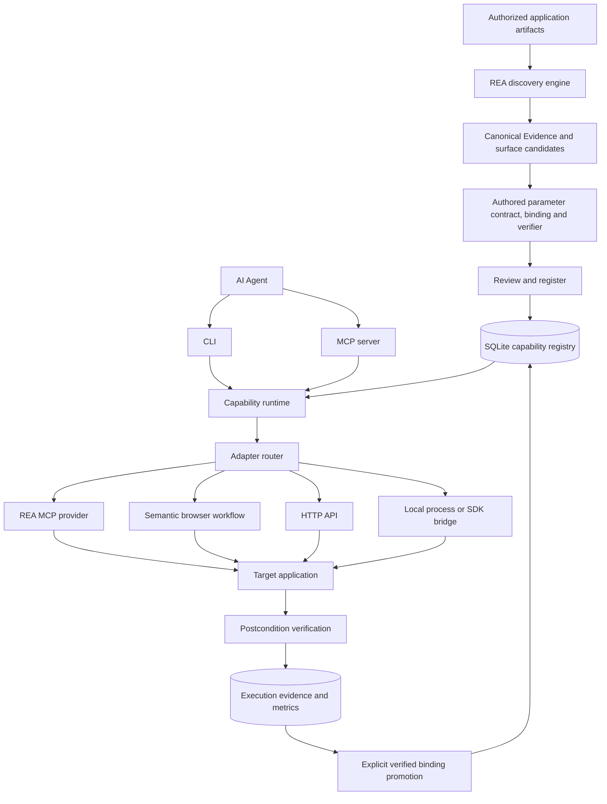

# Architecture

The project builds on the published REA runtime through its public MCP boundary.
REA owns analysis, provider lifecycle and canonical Evidence. CLI Anything owns
application capability contracts, approval, routing, execution policy, verification
and agent-facing presentation.

## Capability graph

Each application's names form a stable semantic hierarchy (`document.export`,
`image.resize`, etc.). `graph` projects namespace and implementation edges.
Bindings are implementation details behind that name. The discovery report
separately retains REA's richer application graph and evidence authorities.
They are different models: a static IPC finding does not become an executable
capability merely because a graph edge exists.

## Routing and interface upgrades

The runtime selects the highest-priority binding, breaking ties by binding ID.
`--binding` selects a particular implementation for explicit comparative testing.
A successful, verified execution against the current manifest/source-directory
digest is required before `promote` can raise its priority. Priority changes
produce a new manifest digest. Metrics are scoped to that current digest;
historical execution records remain accessible by ID.

The current router does not infer reliability from historical averages or fall
back after errors. A timeout or failed verification can occur after a side effect;
retrying a different binding could duplicate it. Recovery is an explicit action.

## Verification and uncertainty

Input is validated before adapter execution. An optional output schema is checked
after execution. At least one declared result or file postcondition must pass.
The browser adapter also requires nonempty UI preconditions and postconditions.

Execution records contain the selected binding, manifest identity, timing,
verification checks, results, optional canonical REA Evidence and error code.
Verification strength depends on the authored conditions. A ready flag proves
only that flag; a file existence check does not prove file content correctness.
The registry's manifest digest does not attest mutable files used by an adapter.

## Extension boundary

Implement the exported `Adapter` interface and add it to the adapter map supplied
to `Runtime` and `validateManifest`. Configuration is validated on import and
again before execution. Adapters receive a source directory, abort signal and
result budget. Code-based plugins are trusted code, not a sandbox.

`src/rea.ts` owns the upstream MCP boundary. `src/discovery/rea.ts` projects
producer-owned graph fields. `src/adapters/rea.ts` maps reviewed arguments to a
fixed REA tool. No private upstream TypeScript module is imported.

## Software-family coverage

| Family | Current integration | Further work |
|---|---|---|
| Web | Semantic UI replay; REA scenario replay; HTTP | Autonomous UI discovery, authenticated workflow lifecycle |
| Electron | REA static discovery; reviewed REA tool calls | Safe application-specific IPC invocation and bindings |
| Native macOS | Process/SDK bridges can be authored | Accessibility adapter, AppleScript helper lifecycle |
| Native Windows | Process/SDK bridges can be authored | UI Automation, COM and native helper support |
| Java/.NET | Application-specific bridge interface | Managed runtime discovery and execution adapters |
| Legacy/remote | No generic execution implementation | Accessibility and vision fallback with identity checks |
